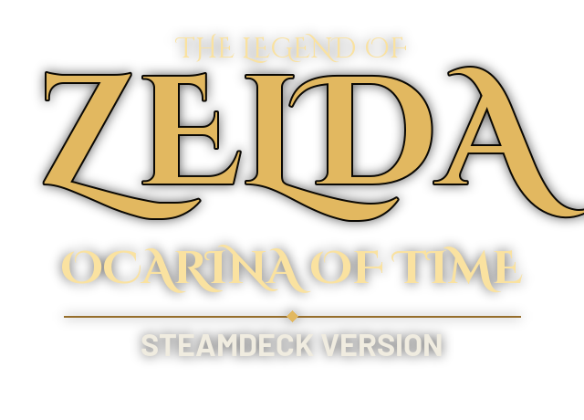

<p align="center"></p>

<p align="center"><a href="README.pt-BR.md">Português</a> • <b>English</b></p>

# Deckport: The Legend of Zelda: Ocarina of Time

**Deckport** is a Steam Deck port of the Ocarina of Time remake (Switch 2), with no emulator. It runs on
[Hookshot](https://github.com/NotRexed/Hookshot), by NotRexed, which recompiles the game for PC. Deckport adds the
Deck-specific work: an adjusted renderer, content cuts for the device's memory and CPU, its own menu, and an installer
that needs no keyboard or mouse.

**This is a test version.** The game is playable, but it has known defects, listed below. It was opened so that more
people can test more areas of the game.

**You need your own copy of the game**, as a `.nup` file. This repository has no game files and nothing from the game
is downloaded.

## What works

- The game is playable on the Steam Deck LCD, at 24 to 31 fps in most of the areas tested (Kokiri Forest, Hyrule
  Field, Lon Lon Ranch, Castle Town, Kakariko).
- Full screen at 16:10, at the Deck's resolution.
- Steam Deck button icons in the game's texts and menus (a Hookshot feature).
- A port menu in the game's style, with presets and options for textures, vegetation distance, grass and shadows.
- Its own start-up screen while the shaders are prepared.
- The Deck's gyroscope, and the Steam button pauses the game.
- Each session keeps a log with fps, memory and memory pressure, for anyone who wants to report a problem.

## Known defects

- **Flicker.** Grass can turn white for one frame, mostly when turning the camera in open areas. The cause is known
  (the GPU reads data the game has already rewritten) and the fix is in progress.
- **Wrong fog** in some areas, such as the Castle Town market. Probably the same cause.
- **Memory at the limit.** The game uses almost all of the Deck's memory. If it really runs out, the port closes the
  game before the Deck freezes.
- **Slow first start.** Preparing the shaders takes over 30 minutes, only once.
- **Only the beginning of the game was tested.** Other Deck owners report GPU hangs in later areas.
- Building the game on the Deck itself takes one to two hours.

## What you need

- A Steam Deck (LCD or OLED) with SteamOS.
- The `.nup` file of your copy of the game, with update v131072 (the one Hookshot v2.1.0 asks for).
- 45 GB free for the build. Once installed, the game takes about 35 GB.
- If you already built the game with **Hookshot v2.1.0**, you can point to that folder and skip the build.

## How to install

1. On the Deck, switch to Desktop Mode.
2. Download [Instalar-Zelda-OoT.desktop](https://github.com/KewinBR/deckport-zelda-oot/releases/latest) and open it.
   Or, in Konsole:
   ```bash
   curl -L https://github.com/KewinBR/deckport-zelda-oot/releases/latest/download/instalar.sh | bash
   ```
3. The installer finds the `.nup` on the Deck and the SD card, asks where to install and does the rest: it downloads
   the official Hookshot, builds the game, installs the port's renderer, generates the Deck's textures and vegetation,
   and creates the Steam shortcut.
4. Go back to Game Mode and launch it from your library.

The installer changes nothing in the system. Everything stays in your home folder and, if you choose it, on the SD
card.

## Updating and uninstalling

To update, run the installer again (step 2 above). It downloads the latest version and keeps the work already done:
the built game and the textures are not made again.

To uninstall, in Konsole:
```bash
python3 ~/.local/share/zelda-oot-deck/instalador/desinstalar.py
```
This removes the Steam shortcut, the port, its settings, the generated mods and the logs. Your saves stay in
`~/.local/share/hookshot`, and the built game folder stays too, back on Hookshot's original renderer. Add
`--com-jogo` to also delete the game folder the installer built. A folder you built yourself before the port is never
deleted.

## How to report a problem

Open an issue and attach the log of the session where the problem happened. The logs are in `zelda-oot-deck/logs/`,
inside the location you chose at install time. Say which area of the game and what you were doing.

## What is Hookshot's and what is Deckport's

Hookshot does the heavy lifting: recompiling the game, translating the shaders and drawing with Vulkan. The Deck
button icons are also its work. Deckport replaces the renderer with a version changed for the Deck, and adds the
launcher, the mods generated from your copy of the game, the menu and the installer.

The renderer changes are in [patches/](patches/), as scripts applied on top of Hookshot v2.1.0, and
`deckport-210.patch` holds the whole difference.

## Credits and license

- [Hookshot](https://github.com/NotRexed/Hookshot), by NotRexed and contributors, under GPL-3.0.
- Deckport by Kewin Lima.
- Fonts: Cinzel Decorative and Barlow, under the SIL Open Font License.

This repository is distributed under GPL-3.0, the same license as Hookshot. The Legend of Zelda is a trademark of
Nintendo. This project is not affiliated with Nintendo.
