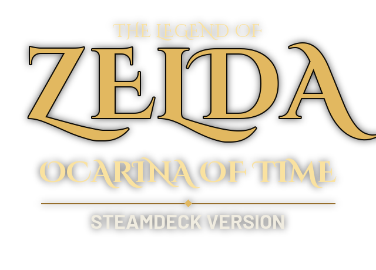

<p align="center"></p>

<p align="center"><b>Português</b> • <a href="README.md">English</a></p>

# Deckport: The Legend of Zelda: Ocarina of Time

O **Deckport** é um port para Steam Deck do remake de Ocarina of Time (Switch 2), sem emulador. Ele roda sobre o
[Longshot](https://git.magicbean.dev/MagicBeanDev/Longshot), de MagicBeanDev, a continuação do Hookshot de NotRexed,
que recompila o jogo para PC. O Deckport acrescenta o trabalho específico do Deck: um renderizador ajustado, cortes de
conteúdo para a memória e a CPU do aparelho, menu próprio e um instalador que dispensa teclado e mouse.

**Esta é uma versão de teste.** O jogo é jogável, mas tem defeitos conhecidos, listados abaixo. Ela foi aberta para
que mais gente teste em mais áreas do jogo.

**Você precisa da sua própria cópia do jogo**, num arquivo `.nup`. Este repositório não tem nenhum arquivo do jogo e
nada do jogo é baixado.

## O que funciona

- Jogo jogável no Steam Deck LCD, de 20 a 30 fps na maior parte das áreas testadas (Floresta Kokiri, campo, rancho
  Lon Lon, cidade do castelo, Kakariko).
- Tela cheia em 16:10, na resolução do Deck.
- Ícones de botão do Steam Deck nos textos e menus do jogo.
- Menu do port no estilo do jogo, com predefinições e opções de textura, distância da vegetação, grama e sombra.
- Giroscópio do Deck, e o botão Steam pausa o jogo.
- Cada sessão guarda um log com fps, memória e pressão de memória, para quem quiser relatar um problema. Os botões de
  trás (L4, R4, L5, R5) guardam um print e o log daquele momento.

## Defeitos conhecidos

- **Memória no limite.** O jogo ocupa quase toda a memória do Deck. Numa sessão de quase uma hora o swap encheu, e o
  port fechou o jogo para o Deck não congelar. Salve com frequência.
- **Objetos sem textura ou faltando por alguns segundos** na primeira vez em cada área, enquanto os shaders dela são
  preparados.
- **Piscadas.** A grama pode ficar branca por um quadro, principalmente ao girar a câmera em área aberta.
- **Névoa errada** em algumas áreas, como o mercado da cidade do castelo.
- **A tela de abertura do port está desligada nesta versão.** Com o renderizador do Longshot ela travava na frente do
  jogo no Modo de Jogo, e o jogo agora abre direto no título.
- **Só o começo do jogo foi testado.** Outros donos de Deck relatam travadas da GPU em áreas mais adiante.
- A montagem do jogo no próprio Deck leva de uma a duas horas. Ela compila o renderizador do port e já prepara os
  shaders com ele, então a primeira abertura não repete esse trabalho.
- **A montagem a partir do `.nup` usa o código do próprio Longshot**, e o instalador ainda não a fez do começo ao fim
  nos nossos testes. A montagem a partir de uma pasta já montada (o mesmo builder, só sem ler o `.nup`) foi testada.
  Se falhar, abra uma issue com o arquivo `zelda-oot-deck/logs/montagem.log`.

## Do que você precisa

- Steam Deck (LCD ou OLED) com SteamOS.
- O arquivo `.nup` da sua cópia do jogo, com a atualização v131072 (a mesma que o Hookshot pedia).
- 45 GB livres para a montagem. Depois de instalado, o jogo ocupa uns 35 GB.
- Quem já montou o jogo com o **Hookshot** ou com o **Longshot** pode apontar essa pasta. O instalador monta o jogo de
  novo com o Longshot a partir dos arquivos que a pasta guarda, sem o `.nup`, e no mesmo disco bastam uns 20 GB livres.
  A sua pasta fica como está.

## Como instalar

1. No Deck, entre no Modo Desktop.
2. Baixe o arquivo [Instalar-Zelda-OoT.desktop](https://github.com/KewinBR/deckport-zelda-oot/releases/latest) e
   abra. Ou, pelo Konsole:
   ```bash
   curl -L https://github.com/KewinBR/deckport-zelda-oot/releases/latest/download/instalar.sh | bash
   ```
3. O instalador acha o `.nup` no Deck e no cartão SD, pergunta onde instalar e faz o resto: baixa o Longshot oficial
   (a nightly-189, com a soma SHA-256 conferida), aplica nele as alterações do port, monta o jogo (o renderizador do
   port é compilado junto), gera as texturas e a vegetação do Deck e cria o atalho na Steam.
4. Volte ao Modo de Jogo e abra pela biblioteca.

O instalador não muda nada no sistema. Tudo fica na sua pasta pessoal e, se você escolher, no cartão SD. Quem jogava
no Hookshot tem os saves copiados para o Longshot na instalação; a pasta de saves do Hookshot fica como estava.

## Atualizar e desinstalar

A partir da v0.1.1 o port se atualiza sozinho. A cada abertura ele vê, em segundo plano, se saiu versão nova e a
baixa; ela entra na abertura seguinte. Quando a versão nova muda a base do Longshot, o jogo precisa ser montado de novo:
isso acontece sozinho com o jogo fechado e o Deck na tomada, numa pasta ao lado, e leva de uma a duas horas. Até
terminar, você joga na versão que já tem; abrir o jogo pausa a montagem. As texturas e a vegetação não são refeitas.
O registro fica em `zelda-oot-deck/logs/atualizacao.log`. Para desligar, ponha `"atualizar": false` em
`~/.config/zelda-oot-deck/config.json`.

Quem instalou a v0.1.0 precisa rodar o instalador uma vez (passo 2 acima) para ganhar a atualização automática.

Para desinstalar, no Konsole:
```bash
python3 ~/.local/share/zelda-oot-deck/instalador/desinstalar.py
```
Isso tira o atalho da Steam, o port, o Longshot baixado, a configuração, os mods gerados e os logs. Os saves continuam
em `~/.local/share/longshot`, e a pasta do jogo montado também fica (com o renderizador do port, que foi compilado
nela).
Com `--com-jogo`, a pasta do jogo que o instalador montou também é apagada. Uma pasta que você montou antes do port
nunca é apagada.

## Como relatar um problema

Abra uma issue e anexe o log da sessão em que o problema aconteceu. Os logs ficam em `zelda-oot-deck/logs/`, dentro
do local que você escolheu na instalação. Diga a área do jogo e o que você estava fazendo.

## O que é do Longshot e o que é do Deckport

O Longshot (e antes dele o Hookshot) faz o trabalho pesado: recompilar o jogo, traduzir os shaders e desenhar com
Vulkan. Os ícones de botão do Deck também são dele. O Deckport altera o renderizador para o Deck e acrescenta o
lançador, os mods gerados a partir da sua cópia do jogo, o menu, o instalador e a atualização automática.

As alterações estão em [patches/](patches/). `deckport-longshot-nightly-189-aa95d35f.patch` é a diferença inteira sobre
as fontes da nightly-189 do Longshot: as alterações do Deck e cinco correções do Longshot que saíram depois dela (a
memória devolvida quando o Linux fica sem, shaders grandes que ficavam de fora, a correção das páginas atrasadas e o
caminho alternativo dos mesh shaders). O instalador aplica esse patch e o `patch_800p.py` (a saída de 1424x800 também
no perfil portátil) nas fontes do builder antes de montar.

## Créditos e licença

- [Longshot](https://git.magicbean.dev/MagicBeanDev/Longshot), de MagicBeanDev e colaboradores, sob GPL-3.0.
- Hookshot, de NotRexed e colaboradores, sob GPL-3.0, de onde o Longshot continua.
- Deckport por Kewin Lima.
- Fontes: Cinzel Decorative e Barlow, sob a SIL Open Font License.

Este repositório é distribuído sob a GPL-3.0, a mesma licença do Longshot e do Hookshot. The Legend of Zelda é marca
da Nintendo. Este projeto não tem vínculo com a Nintendo.
